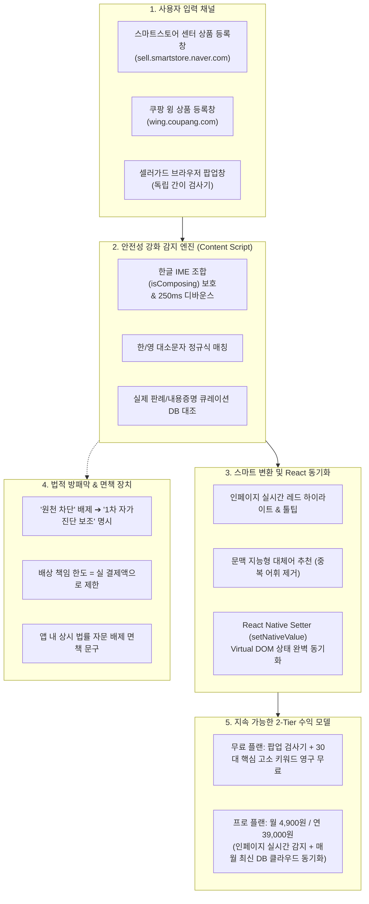

# 셀러가드 (SellerGuard) - 제품 기획 및 비즈니스 마스터 스펙

> **제품명:** 셀러가드 (SellerGuard)  
> **부제:** 스마트스토어 & 쿠팡 셀러 전용 1초 상표권 사전 자가진단 레이더 (크롬 확장 프로그램)  
> **타깃 고객:** 스마트스토어, 쿠팡, 위탁판매, 해외구매대행 셀러 (초보~중급)  
> **핵심 가치:** "월 4,900원으로 상품 등록 전 1초 만에 상표권 분쟁 위험을 사전 스크리닝"  
> **버전:** 1.1.0 (Audit & Hardened Edition)  
> **상태:** 테크-리걸 감사 완료 및 견고화(Hardening) 단계  

---

## 1. 시스템 핵심 아키텍처 (보안 및 법적 방패막 포함)



---

## 2. 법적 리스크 방어 및 필수 면책 조항 (Legal Shield)

단 1원의 결제를 받기 전과 확장 프로그램 최초 실행 시, 개발자를 보호하기 위해 아래 법적 방패막을 필수 가동한다.

### A. 마케팅 표현 전면 순화
* ❌ **금지 표현:** `로펌 합의금 300만 원 원천 차단`, `100% 무조건 방어` (법률상 '결과 보증'으로 해석되어 피소 위험)
* ⭕ **정식 표기:** **`특허청 출원 전, 1초 만에 걸러내는 초보 셀러 필수 상표권 사전 진단 레이더`**

### B. 3대 필수 면책 조항 (Terms of Service)
1. **비보증 및 자문 배제 (No Legal Advice):**  
   본 프로그램은 단순 텍스트 패턴 매칭에 기반한 자가진단 보조 도구이며, 변호사법상 법률 자문이나 특허청 공식 심사를 대신하지 않습니다.
2. **결과 면책 (Disclaimer of Liability):**  
   지정상품 유사 여부, 상표권 신규 출원 상태에 따라 미감지(False Negative) 또는 오감지(False Positive)가 발생할 수 있으며, 본 프로그램 사용 중 발생한 어떠한 직접·간접적 손해(내용증명 수령, 합의금, 소송 비용, 플랫폼 계정 정지 등)에 대해서도 개발사는 일체의 민·형사상 책임을 부담하지 않습니다.
3. **손해배상 책임 한도 고정 (Limitation of Liability):**  
   어떠한 법률적 다툼이 발생하더라도 개발사의 배상 책임 총액은 **"이용자가 본 서비스 이용을 위해 지불한 실 결제 금액"**을 절대 초과할 수 없습니다.

---

## 3. 기술적 취약점 해결 아키텍처 (Technical Specifications)

### A. React / Vue Virtual DOM 완벽 동기화
스마트스토어와 쿠팡은 React/Vue 기반 SPA이므로 단순 `input.value = ...` 대입 시 내부 상태가 갱신되지 않고 원래 값으로 되돌아가는 현상이 발생함. 이를 방지하기 위해 **React Native Setter 패턴**을 적용함.

```javascript
// React Virtual DOM 강제 동기화 함수
function setNativeValue(element, value) {
  const valueSetter = Object.getOwnPropertyDescriptor(element, 'value')?.set;
  const prototype = Object.getPrototypeOf(element);
  const prototypeValueSetter = Object.getOwnPropertyDescriptor(prototype, 'value')?.set;
  
  if (prototypeValueSetter && valueSetter !== prototypeValueSetter) {
    prototypeValueSetter.call(element, value);
  } else if (valueSetter) {
    valueSetter.call(element, value);
  } else {
    element.value = value;
  }
  element.dispatchEvent(new Event('input', { bubbles: true }));
  element.dispatchEvent(new Event('change', { bubbles: true }));
}
```

### B. 한글 조합(IME) 충돌 방지 및 타이핑 랙 해결
* 한글은 조합형 문자이므로 사용자가 타이핑 중인 상태(`e.isComposing === true`)에서는 감지 루프를 정지하여 자모 분리(`ㄱㅡㄹㅣㅂㅌㅗㄱ`) 버그를 원천 차단.
* 타이핑 완료(`compositionend`) 또는 입력 중단 후 **250ms 디바운스(Debounce)**를 적용하여 브라우저 메인 스레드 프리징을 방지.

### C. 동적 셀렉터 대응 (Dynamic Selector Strategy)
* 특정 CSS 클래스명에만 의존하지 않고, `input[placeholder*="상품명"]`, `input[name="name"]`, `input[id*="product"]` 등 다중 속성 탐색 및 Semantic Selector 적용.

---

## 4. 지속 가능한 비즈니스 & 가격 모델 (Sustainable Monetization)

1회성 19,000원 모델의 인건비/CS 잠식 리스크를 보완하여, **장기적인 정기 현금 흐름(MRR)**을 창출하는 구독 모델로 개정.

| 플랜 | 가격 | 제공 혜택 | 포지셔닝 |
| :--- | :--- | :--- | :--- |
| **Free (무료)** | **0원** | • 브라우저 팝업 간이 검사기<br>• 30대 핵심 고소 다발 키워드 영구 무료 검사 | 바이럴 유도 및 사용자 풀 확보 |
| **Pro (월간)** | **월 4,900원** | • 스마트스토어/쿠팡 인페이지 실시간 자동 감지<br>• 원클릭 안전 상품명 자동 치환<br>• 매월 신규 고소 단어 클라우드 실시간 동기화 | 부담 없는 커피 한 잔 값의 셀러 보험 |
| **Pro (연간)** | **연 39,000원**<br>(월 3,250원 꼴 / 34% 할인) | • Pro의 모든 기능 + 연간 결제 할인<br>• 《2026 이커머스 상표권 회피 가이드북 PDF》 무료 증정 | 초기 목돈 현금 흐름 창출 |

---

## 5. 현실적 GTM 마케팅 & 신뢰 구축 전략 (Go-To-Market)

1. **카페 강퇴 방지: 리드 마그넷(Lead Magnet) 전략**:
   * 광고성 글 대신 **"실제 로펌 내용증명이 날아온 상표권 30선 분석 및 안전 대체어 정리집 (PDF)"**을 셀러 카페에 무료 나눔.
   * 자료집 하단에 "이 단어들을 자동으로 걸러주는 무료 크롬 확장 프로그램"으로 자연스러운 다운로드 유도.
2. **보안 의구심 원천 해소**:
   * 셀러들의 계정 탈취/매출 유출 공포를 해소하기 위해 **"어떠한 개인정보, 매출 데이터, 비밀번호도 서버로 전송하지 않는 안전한 로컬 기반 도구"**임을 팝업 하단에 인증 뱃지로 상시 표기.

---

## 6. 개정된 개발 로드맵 (v1.1.0)

- [x] 팝업 UI 및 한/영 대소문자 기본 감지 엔진 구축
- [x] 문맥 지능형 스마트 치환 로직 구현
- [x] 테크-리걸 감사 완료 및 스펙 문서 v1.1.0 견고화
- [ ] 스마트스토어/쿠팡 인페이지 감지 `content.js` (React 동기화 & IME 보호 탑재)
- [ ] 팝업 UI 내 면책 조항(Disclaimer) 및 보안 안심 뱃지 적용
- [ ] Gumroad / 포트원 결제 및 라이선스 키 활성화 로직 연동
